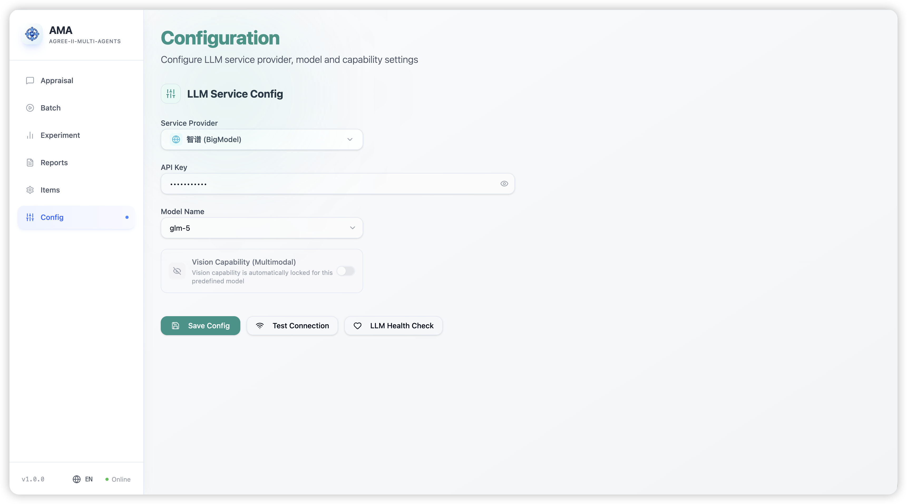
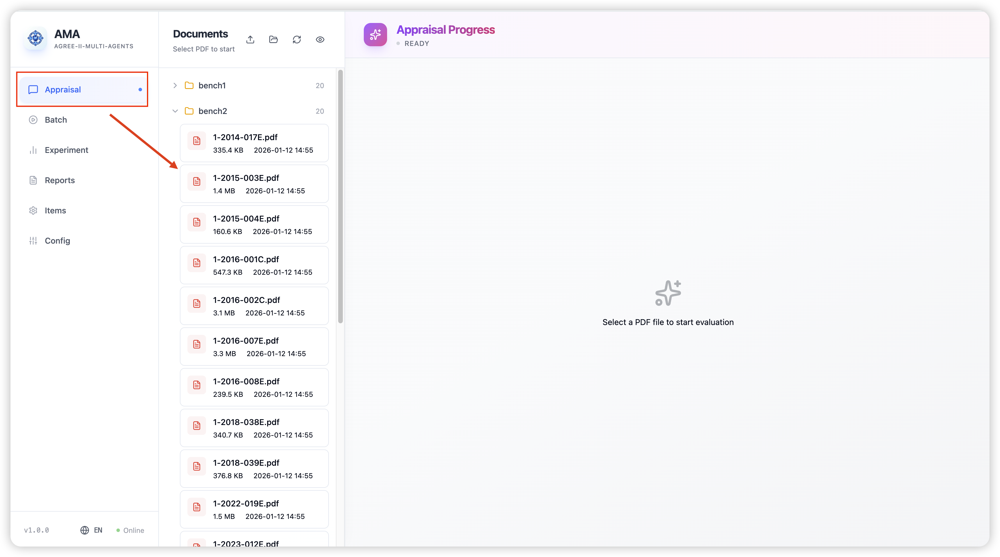
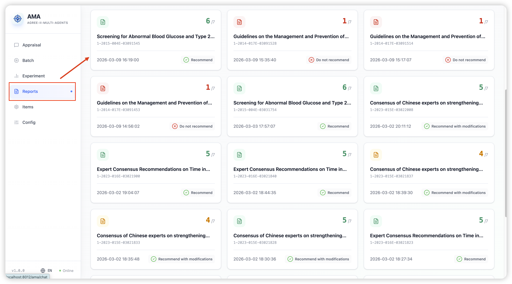
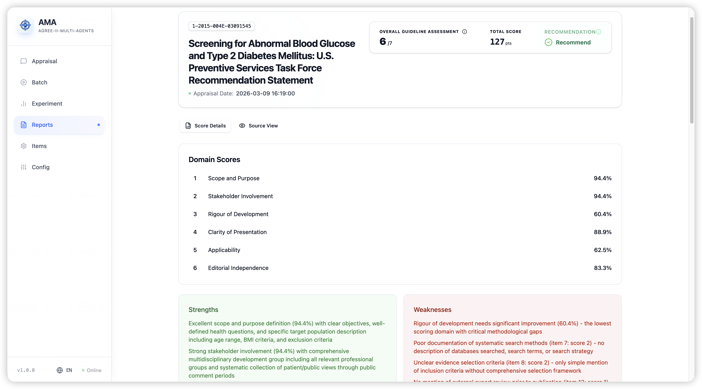
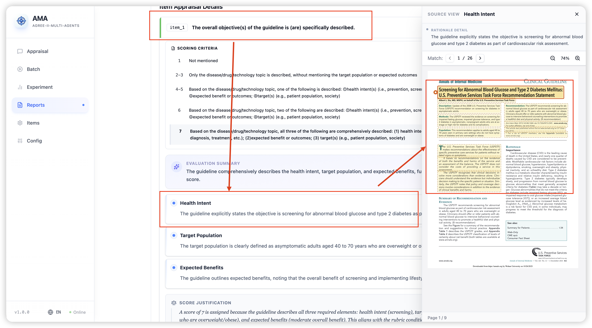

# AGREE-II Multi-Agents 用户使用手册

## 1. 手册说明

如果你是第一次使用，建议按这个顺序进入系统：

1. 先看 `配置`
2. 再去 `评价`
3. 最后到 `报告`

## 2. 页面总览

系统左侧导航栏中，常用页面主要有：

- `评价`：上传或选择指南文件，启动单个评价任务
- `批量`：批量选择多份指南，统一运行评价
- `报告`：查看历史报告和评价详情
- `配置`：检查当前模型连接状态

其他页面：

- `实验`：用于将评价结果与人工评分对比
- `条目`：用于查看和调整条目配置
- `用户`：用于管理账号（仅管理员可见）

## 3. 推荐使用流程

### 3.1 第一步：检查配置

进入 `配置` 页面后，建议先完成两件事：

1. 点击“测试连接”
2. 点击“LLM 健康验证”

如果两项都正常，通常就可以开始使用系统。

如果页面显示连接异常，请先处理连接问题，再开始评价任务。

### 3.2 第二步：选择指南文件

进入 `评价` 页面后，你可以用三种方式准备文件：

- 上传单个 PDF
- 上传包含多份 PDF 的文件夹
- 直接从页面中文件列表里选择已有文件

建议：

- 主指南文件尽量使用清晰、规范的文件名
- 如果存在附件材料，尽量与主文件放在同一目录下，文件名保持关联，例如主文件名为`xxx.pdf`，那么附件建议命名为`xxx_附件1.pdf`等

### 3.3 第三步：启动评价

在 `评价` 页面点击某个 PDF 后，系统会自动开始评价流程。

页面会依次展示任务进度，例如：

- PDF 解析
- 预处理或语义来源整理
- 各条目评价
- 汇总与报告生成

使用时你只需要关注两点：

- 页面是否持续有进度更新
- 最终是否出现完成状态

### 3.4 第四步：查看结果

任务完成后，进入 `报告` 页面查看结果。

你可以在这里：

- 查看历史报告列表
- 打开某份指南的评价详情
- 查看各个 Domain 的分数
- 查看每个条目的评分结果
- 查看推理摘要和证据定位

如果你只是想快速判断一份指南质量，优先看：

- 总体质量评分
- 各 Domain 分数
- 总体推荐结论

如果你要进一步复核，继续看：

- 单条目评分
- 推理说明
- 证据引用位置

## 4. 各页面怎么用

### 4.1 评价 页面

`评价` 是最核心的工作区，适合处理单份指南。

你可以在这里完成：

- 上传 PDF
- 选择已有 PDF
- 启动评价任务
- 观察任务过程

页面中的时序区会展示任务阶段变化。一般来说：

- 持续更新，说明任务仍在正常进行
- 显示完成，说明报告已生成
- 显示错误，说明本次任务需要重试或检查文件

适用场景：

- 单篇指南评价
- 观察评价过程
- 快速验证一份文件能否正常处理

### 4.2 报告 页面

`报告` 用来查看已经完成的评价结果。

常见用法：

- 按列表找到某个任务
- 打开详情页阅读整体结论
- 展开单个条目查看评分依据

这个页面更适合：

- 汇报结果
- 复核评分
- 回看历史任务

### 4.3 批量 页面

`批量` 适合一次处理多份指南。

你可以在这里：

- 选择一个文件夹
- 勾选多份 PDF
- 启动批量任务
- 查看每份任务的运行状态

适用场景：

- 同一批次多篇指南集中评价
- 批量跑结果后再统一去 `报告` 查看

### 4.4 配置 页面

`批量` 页面主要用于确认系统当前是否可用。

你可以关注：

- 当前连接状态
- 测试连接结果
- 健康验证结果

对于普通用户来说，这一页最重要的作用是：

- 在开始任务前做一次可用性确认

## 5. 查看结果

查看一份报告时，通常可以按下面顺序理解结果：

### 5.1 总体评分

优先关注：

- 指南名称
- 评价时间
- 总体质量评分
- 推荐结论

这部分适合快速判断这份指南整体质量如何。

### 5.2 Domain 分数

系统会按 AGREE-II 的 Domain 展示分数。

这部分适合回答两个问题：

- 哪些方面做得较好
- 哪些方面相对薄弱

### 5.3 条目详情

如果需要更细的分析，可查看单个条目。

每个条目通常可以看到：

- 条目标题
- 分数
- 评分依据
- 推理摘要
- 相关证据

这部分适合：

- 人工复核
- 写总结意见
- 解释为什么给出这个分数

## 6. 常见使用场景

### 6.1 场景一：评价一份新指南

操作顺序：

1. 进入 `配置` 检查状态
2. 进入 `评价` 上传或选择 PDF
3. 等待任务完成
4. 进入 `报告` 查看结果

### 6.2 场景二：一次评价多份指南

操作顺序：

1. 进入 `批量`
2. 选择文件夹并勾选多份 PDF
3. 启动批量任务
4. 任务完成后进入 `报告` 统一查看

### 6.3 场景三：复核某个评分

操作顺序：

1. 进入 `报告`
2. 打开目标报告
3. 找到对应条目
4. 查看推理说明和证据定位

## 7. 常见问题

### 7.1 为什么在 评价 里点了文件后没有马上结束？

这是正常现象。系统会依次完成解析、预处理、条目评价和报告生成，通常需要一段时间。

### 7.2 为什么我看不到报告？

通常先检查两点：

- 任务是否已经完成
- `报告` 页面中是否已有新的记录

如果任务过程里出现错误状态，本次报告可能没有成功生成。

### 7.3 我应该用 评价 还是 批量？

可以这样判断：

- 只处理一份指南：用 `评价`
- 一次处理多份指南：用 `批量`

### 7.4 我只想看最终结论，应该看哪里？

进入 `报告`，先看：

- 总体质量评分
- 推荐结论
- 各 Domain 分数

### 7.5 我想知道某个条目为什么是这个分数，应该看哪里？

进入 `报告` 的详情页，展开对应条目，查看：

- 评分依据
- 推理摘要
- 证据定位
