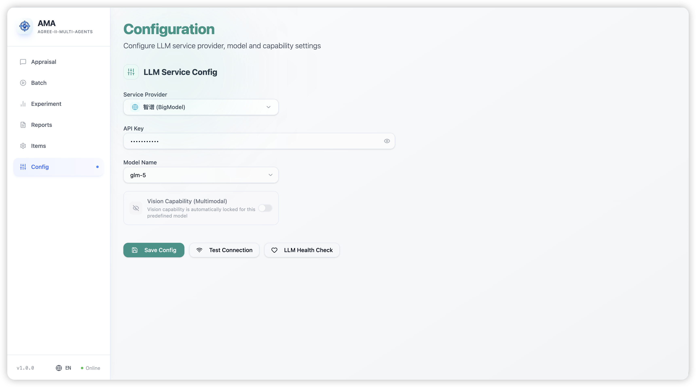
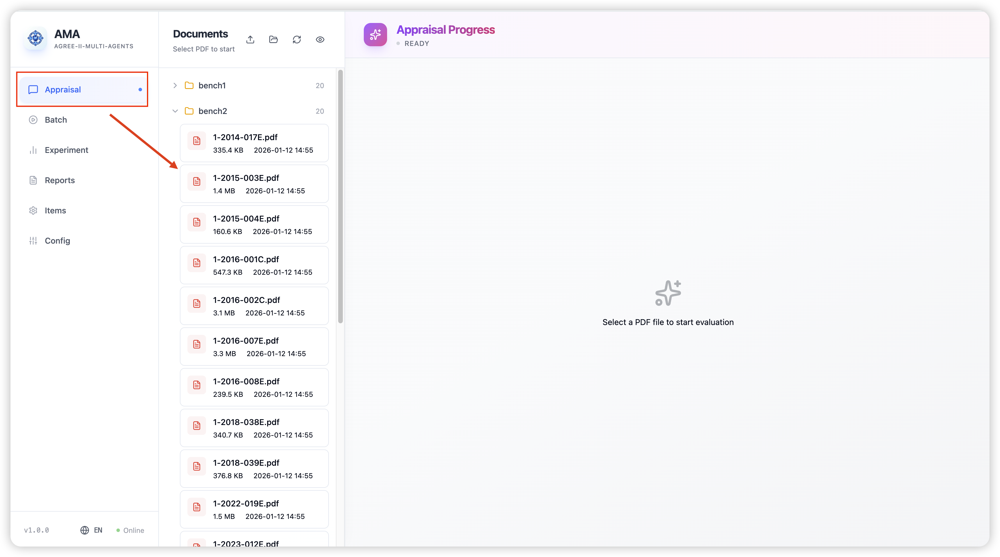
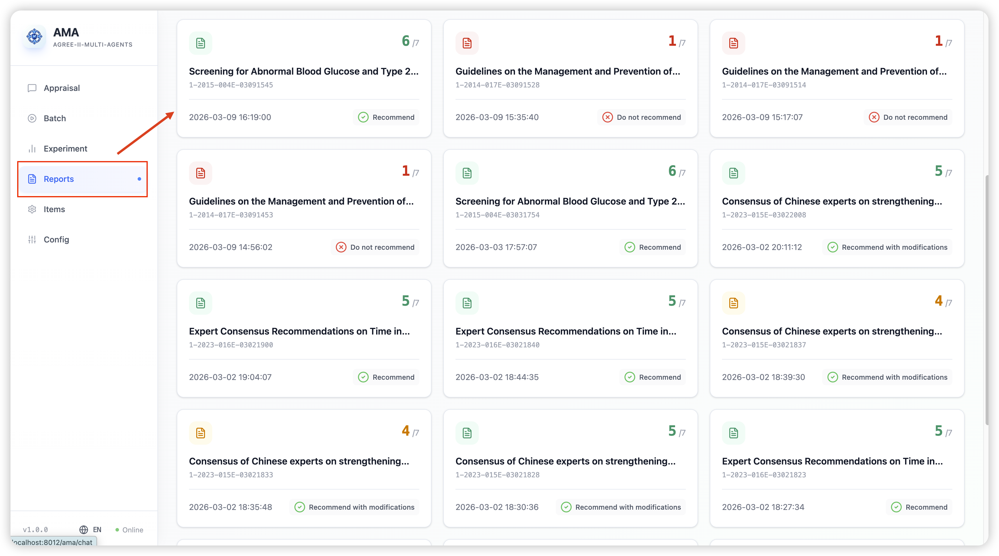
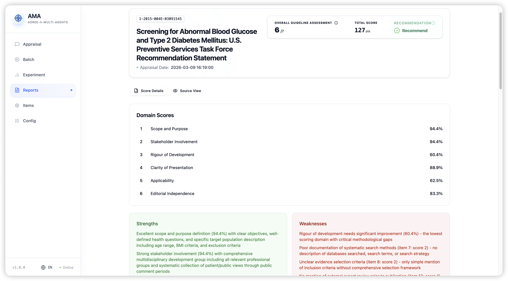
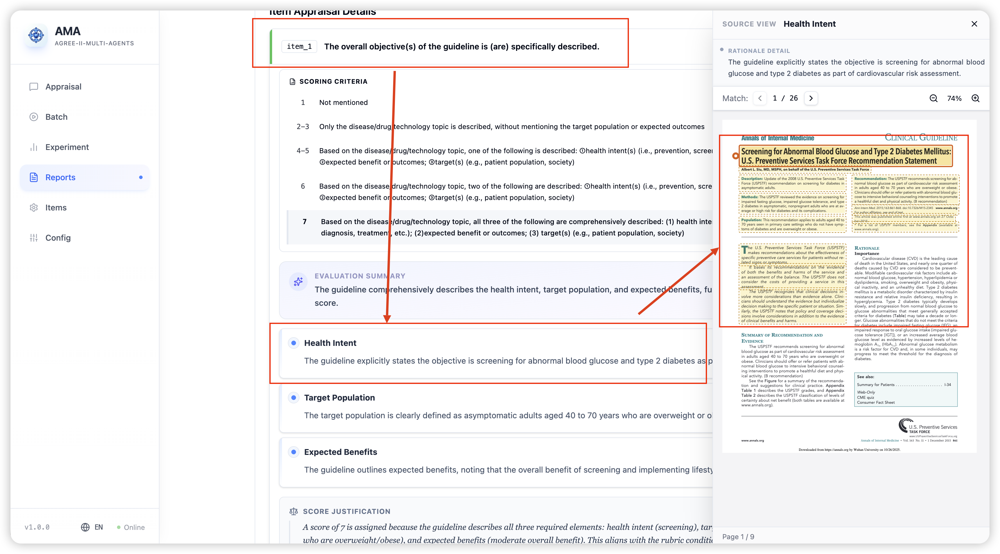

# AGREE-II Multi-Agents User Manual

## 1. About This Manual

If you are using the system for the first time, the recommended workflow is:

1. Open `Config`
2. Go to `Appraisal`
3. Review the results in `Reports`

## 2. Page Overview

The left navigation panel includes the following commonly used pages:

- `Appraisal`: Upload or select guideline files and start a single appraisal task
- `Batch`: Select multiple guideline files and run appraisals in batch
- `Reports`: View historical reports and detailed appraisal results
- `Config`: Check the current model connection status

Other pages:

- `Experiment`: Compare appraisal results with human scores
- `Items`: View and adjust item configurations
- `Users`: Manage accounts (administrators only)

## 3. Recommended Workflow

### 3.1 Step 1: Check the Configuration

On the `Config` page, it is recommended to complete the following two checks before starting:

1. Click `Test Connection`
2. Click `LLM Health Check`

If both checks pass, the system is generally ready for use.

If the page shows a connection error, resolve the issue before starting an appraisal task.

### 3.2 Step 2: Select a Guideline File

On the `Appraisal` page, you can prepare files in three ways:

- Upload a single PDF
- Upload a folder containing multiple PDF files
- Select an existing file directly from the file list

Recommendations:

- Use clear and consistent names for main guideline files
- If supporting materials are included, keep them in the same folder as the main file and use related file names. For example, if the main file is named `xxx.pdf`, attachments may be named `xxx_attachment_1.pdf`, `xxx_attachment_2.pdf`, and so on

### 3.3 Step 3: Start the Appraisal

After you click a PDF file on the `Appraisal` page, the system will start the appraisal workflow automatically.

The page will display task progress step by step, for example:

- PDF parsing
- Preprocessing or semantic source preparation
- Item-level appraisal
- Aggregation and report generation

While the task is running, you mainly need to watch for two things:

- Whether the page continues to show progress updates
- Whether the task eventually reaches a completed state

### 3.4 Step 4: Review the Results

After the task is completed, go to the `Reports` page to review the results.

On this page, you can:

- Browse the report history
- Open the detailed appraisal result for a specific guideline
- Review scores for each Domain
- Review item-level scores
- Inspect reasoning summaries and evidence locations

If you only need a quick judgment of guideline quality, focus on:

- Overall quality score
- Domain scores
- Overall recommendation

If you need a deeper review, continue with:

- Item-level scores
- Reasoning details
- Evidence references

## 4. How to Use Each Page

### 4.1 Appraisal Page

The `Appraisal` page is the main workspace for processing a single guideline.

You can use this page to:

- Upload a PDF
- Select an existing PDF
- Start an appraisal task
- Monitor task progress

The timeline area shows how the task progresses through each stage. In general:

- Continuous updates indicate the task is still running normally
- A completed status indicates that the report has been generated
- An error status indicates that the task should be retried or the input file should be checked

Typical use cases:

- Appraising a single guideline
- Monitoring the appraisal process
- Quickly verifying whether a file can be processed successfully

### 4.2 Reports Page

The `Reports` page is used to review completed appraisal results.

Common actions include:

- Finding a specific task from the report list
- Opening the detail page to read the overall conclusion
- Expanding individual items to inspect the scoring basis

This page is most useful for:

- Presenting results
- Reviewing scores
- Revisiting completed tasks

### 4.3 Batch Page

The `Batch` page is designed for processing multiple guidelines at once.

You can use it to:

- Select a folder
- Choose multiple PDF files
- Start a batch appraisal run
- Monitor the status of each task

Typical use cases:

- Running appraisals for a group of guidelines in one batch
- Reviewing all outputs later from the `Reports` page

### 4.4 Config Page

The `Config` page is mainly used to confirm that the system is currently available.

You can check:

- Current connection status
- Connection test results
- Health check results

For most users, the main purpose of this page is:

- Confirming that the system is ready before starting a task

## 5. How to Read the Results

When reviewing a report, it is usually helpful to read it in the following order.

### 5.1 Overall Summary

Focus first on:

- Guideline title
- Appraisal date
- Overall quality score
- Recommendation

This section is useful for making a quick overall judgment.

### 5.2 Review Domain Scores

The system presents scores by AGREE-II Domain.

This section helps answer two questions:

- Which areas are stronger
- Which areas are relatively weaker

### 5.3 Review Item Details

If a more detailed analysis is needed, review the individual items.

Each item typically includes:

- Item title
- Score
- Scoring basis
- Reasoning summary
- Supporting evidence

This section is useful for:

- Manual review
- Writing summary comments
- Explaining why a particular score was assigned

## 6. Common Usage Scenarios

### 6.1 Scenario 1: Appraising a New Guideline

Recommended sequence:

1. Open `Config` and check system status
2. Go to `Appraisal` and upload or select a PDF
3. Wait for the task to finish
4. Open `Reports` to review the result

### 6.2 Scenario 2: Appraising Multiple Guidelines at Once

Recommended sequence:

1. Open `Batch`
2. Select a folder and choose multiple PDF files
3. Start the batch task
4. After completion, open `Reports` to review the outputs

### 6.3 Scenario 3: Reviewing a Specific Score

Recommended sequence:

1. Open `Reports`
2. Open the target report
3. Locate the relevant item
4. Review the reasoning details and evidence location

## 7. Frequently Asked Questions

### 7.1 Why does nothing finish immediately after I click a file on the Appraisal page?

This is expected. The system completes several stages in sequence, including parsing, preprocessing, item-level appraisal, and report generation. The full process usually takes some time.

### 7.2 Why can I not see a report?

Check the following first:

- Whether the task has already finished
- Whether a new record appears on the `Reports` page

If the task enters an error state during processing, the report may not have been generated successfully.

### 7.3 Should I use Appraisal or Batch?

Use the following rule of thumb:

- Use `Appraisal` for a single guideline
- Use `Batch` for multiple guidelines in one run

### 7.4 I only want the final conclusion. Where should I look?

Go to `Reports` and focus first on:

- Overall quality score
- Recommendation
- Domain scores

### 7.5 Where can I see why a specific item received its score?

Open the report detail page in `Reports`, expand the corresponding item, and review:

- Scoring basis
- Reasoning summary
- Evidence location
